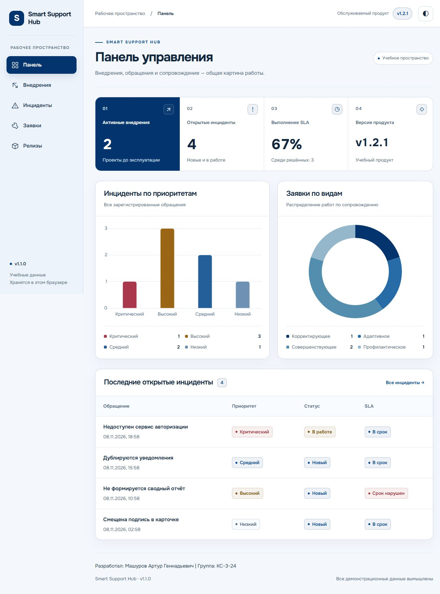
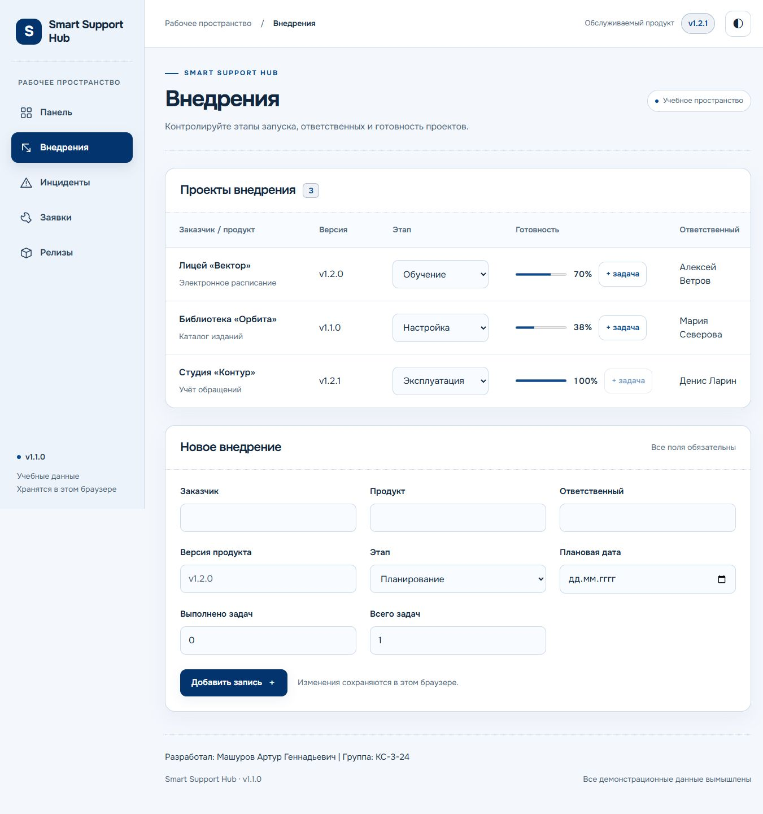
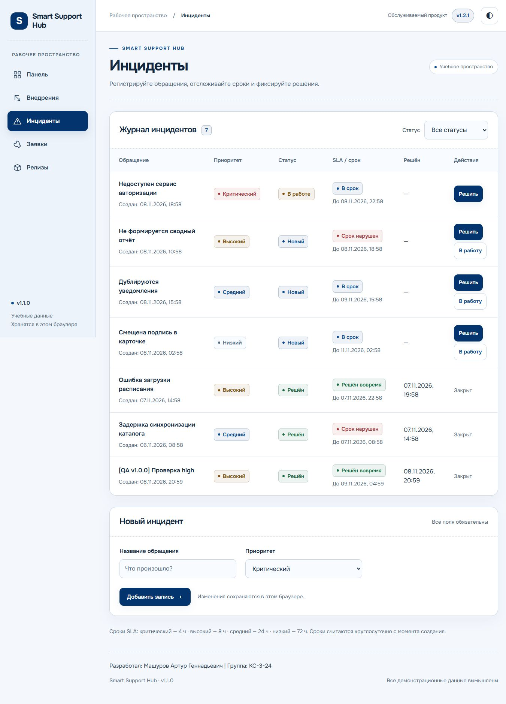
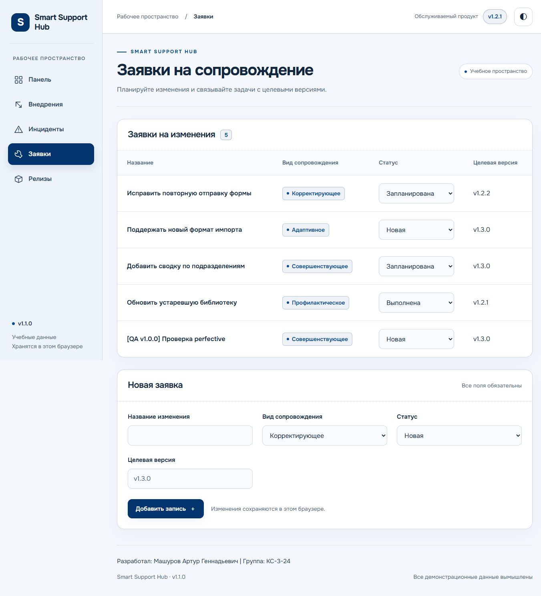
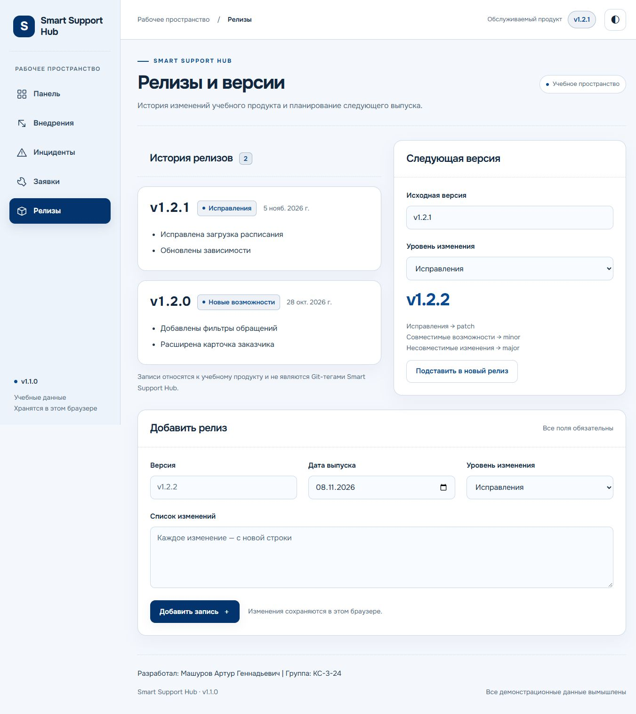

# Smart Support Hub — технический отчёт

Разработал: Машуров Артур Геннадьевич. Группа: КС-3-24. Дата: 8 ноября 2026 года.

## Цель и результат

Создана и опубликована учебная платформа внедрения, эксплуатации и сопровождения программного продукта по оригинальной методичке Smart Support Hub. Реализованы пять рабочих страниц, четыре KPI, две диаграммы Chart.js, SLA, история версий и сохранение данных в браузере.

- [Сайт GitHub Pages](https://unknownkg.github.io/smart-support-hub/)
- [Репозиторий](https://github.com/unknownkg/smart-support-hub)
- [Руководство пользователя](USER_GUIDE.md)
- [Подробный протокол проверок](TEST_RESULTS.md)
- [CHANGELOG](../CHANGELOG.md)

## Реализация

Применены HTML5, CSS3, JavaScript-модули, localStorage и Chart.js 4.4.8. Сервер приложения, база данных и сборка не используются. Node.js нужен только для локального предпросмотра и тестов; npm-зависимостей нет. Onest хранится локально с лицензией OFL, Chart.js загружается с CDN и требует интернета.

Пять HTML-файлов используют общие стили и UI-модуль. core.js содержит SLA, SemVer, валидацию и KPI; storage.js отвечает за чтение, проверку и запись данных. Обработчики страниц используют общую логику. Утверждённое оформление Navy и авторский футер сохранены; при подготовке релизов косметические изменения не выполнялись.

| Раздел | Реализовано |
|---|---|
| Dashboard | Активные внедрения, открытые инциденты, SLA среди решённых, версия продукта; bar по приоритетам и doughnut по видам заявок. |
| Deployments | Три начальные записи, этапы planning/setup/training/production, готовность, добавление и выполнение задач. |
| Incidents | Шесть начальных записей, четыре приоритета, создание, переход в работу, решение с датой и фильтр. |
| Maintenance | Четыре начальные заявки corrective/adaptive/perfective/preventive, статус и целевая версия, создание и изменение статуса. |
| Releases | Два начальных релиза продукта, история изменений, создание релиза и калькулятор patch/minor/major. |

SLA: critical — 4 часа, high — 8, medium — 24, low — 72. Открытый инцидент до дедлайна включительно — on_track, после — breached. Решённый в дедлайн включительно — met, позднее — breached. Если решённых нет, интерфейс сообщает об отсутствии измеренных данных. Для версии v1.2.1 калькулятор даёт v1.2.2, v1.3.0 и v2.0.0.

## Тестирование

Автоматически: первая версия — 8/8, после двух исправлений — 12/12; ошибок нет. HTTP-проверка реального Pages: пять страниц и 19 локальных ресурсов доступны. Браузерная регрессия: пять страниц × 1366/768/390 px × две темы, 30 сочетаний без переполнения документа и форм.

| № | Сценарий методички | Результат на Pages |
|---|---|---|
| 1 | Пустое название инцидента | Запись не создаётся; пробельное название также отклонено. |
| 2 | Создать high | Запись и SLA со сроком 8 часов отображаются. |
| 3 | Решить инцидент | Сохранены статус и дата, Dashboard пересчитан: SLA 50% → 67% в первом прогоне и 67% → 75% во втором. |
| 4 | Создать perfective | Заявка есть в таблице, число на диаграмме увеличилось. |
| 5 | Обновить страницу | Записи, статусы, готовность, релиз и тема сохранились. |
| 6 | 390 px и Console | Мобильная навигация работает; переполнения документа и ошибок/предупреждений JavaScript нет. |

Тестовые записи помечены `[QA]` в отдельном профиле проверочного браузера. Начальные данные вымышлены. Снимки — реальные результаты работы приложения на Pages; подробные условия и различия прогонов указаны в протоколе.

## Версии и сопровождение

Первая публикация закреплена тегом [v1.0.0](https://github.com/unknownkg/smart-support-hub/releases/tag/v1.0.0) на коммите `31d5edc75eaca79e058bcfb94aa2e67712bcf55f`. Первые пять коммитов группируют уже подготовленные файлы по компонентам: структура, функциональность, интерфейс, проверки и документация. Они не изображают прошлую последовательность разработки; даты фактические.

После проверки опубликованной первой версии технический аудит воспроизвёл два независимых дефекта:

| Issue | Исправление и доказательство |
|---|---|
| [#1](https://github.com/unknownkg/smart-support-hub/issues/1) | Устаревший снимок терял новую заявку другого экземпляра. Коммит [dc87fc0](https://github.com/unknownkg/smart-support-hub/commit/dc87fc0) перечитывает актуальные данные перед изменением и блокирует запись при повреждении. Два регрессионных теста прошли после первоначального падения. |
| [#2](https://github.com/unknownkg/smart-support-hub/issues/2) | Календарная дата сдвигалась из-за UTC. Коммит [99aed75](https://github.com/unknownkg/smart-support-hub/commit/99aed75) сохраняет календарный день и использует местную начальную дату формы. Тесты проверяют положительные/отрицательные смещения и границы календаря. |

Оба Issues закрыты после исправления и проверки. Исправления включены в [v1.1.0](https://github.com/unknownkg/smart-support-hub/releases/tag/v1.1.0). Версия обслуживаемого продукта v1.2.1 — отдельные начальные данные; тестовый релиз v1.3.0 меняет только набор проверочного браузера.

Author и Committer всех коммитов: Машуров Артур Геннадьевич, `250739200+unknownkg@users.noreply.github.com`. Конфигурация авторства не менялась. [История](https://github.com/unknownkg/smart-support-hub/commits/main/) · [Теги](https://github.com/unknownkg/smart-support-hub/tags) · [Releases](https://github.com/unknownkg/smart-support-hub/releases) · [Issues](https://github.com/unknownkg/smart-support-hub/issues?q=is%3Aissue%20is%3Aclosed).

## Снимки пяти разделов

## Проверка 30 шагов и ограничения

Шаги 01–26 реализованы и проверены в указанном объёме; шаг 27 — реальный Pages и v1.0.0; шаг 28 — руководство. Для шага 29 выполнены технические Issues, два отдельных исправления, CHANGELOG и второй выпуск v1.1.0. Часть о настоящих отзывах одногруппника **не подтверждена**: технический аудит не выдаётся за человеческую обратную связь. Шаг 30 представлен этим отчётом, снимками и таблицей фактических сценариев.

Данные хранятся отдельно для каждого origin, браузера и устройства; общая база отсутствует. localStorage не обеспечивает атомарность полностью одновременных записей. Диаграммы требуют CDN. Активный системный reduced motion, другие браузеры, реальные телефоны и экранный диктор не проверены. Уменьшение движения нужно дополнительно проверить вручную через ОС/DevTools; анимация Chart.js всегда отключена.

## Вывод

Опубликовано работающее статическое приложение с пятью разделами и сохранением данных. Шесть обязательных сценариев повторены на Pages; аудит первой версии привёл к двум воспроизведённым и проверенным исправлениям. Для полного подтверждения учебного пункта об обратной связи остаётся получить реальные отзывы одногруппника и предъявить проект преподавателю.
